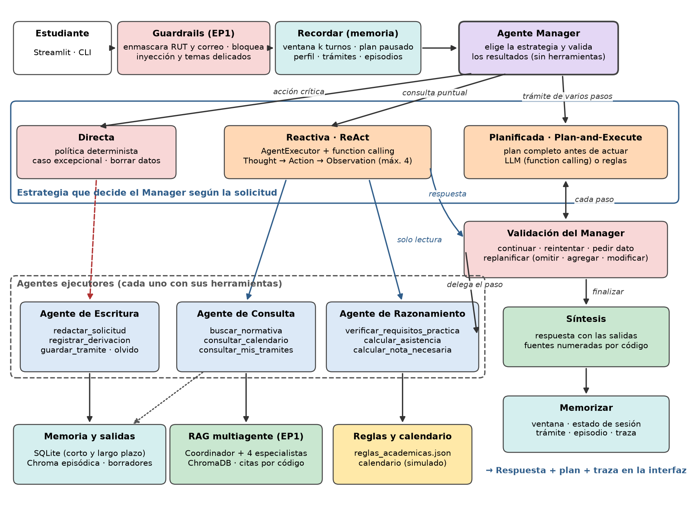
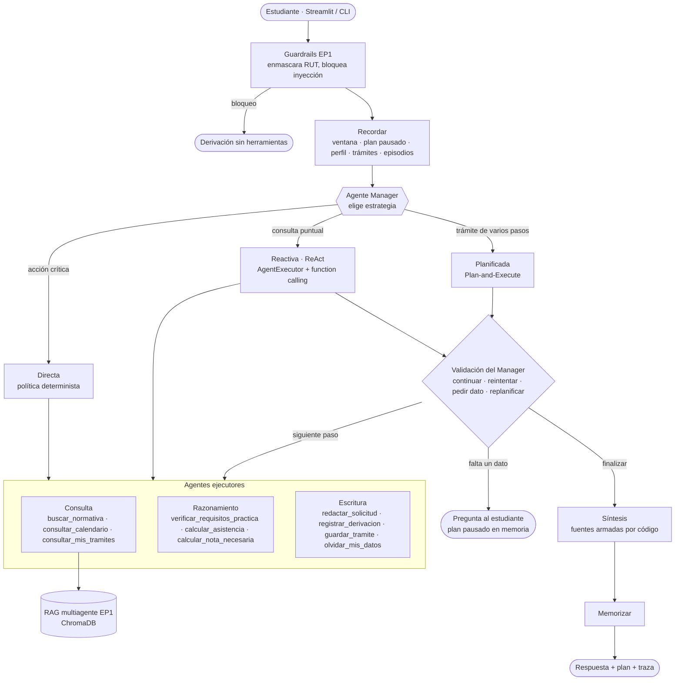
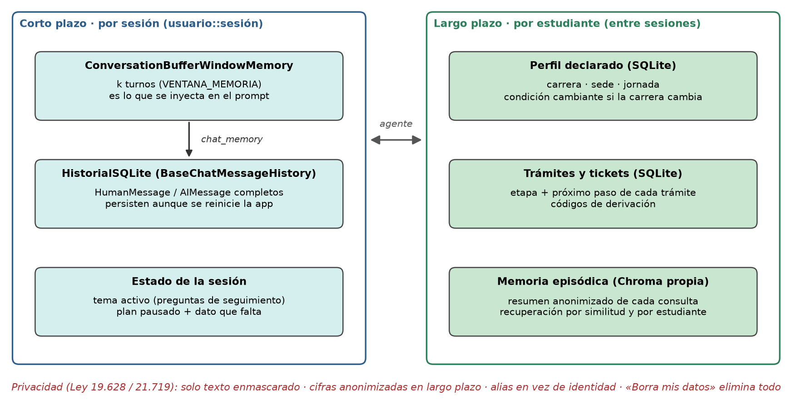
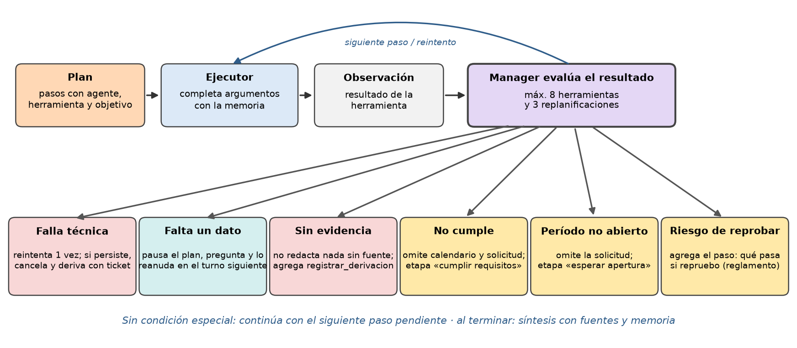
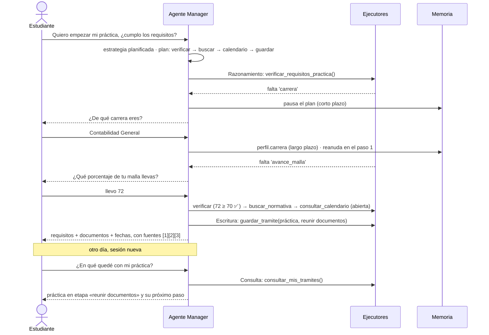

# Asistente Inteligente para Estudiantes Duoc UC · Agente con herramientas, memoria y planificación

Evaluación Parcial N°2 · ISY0101 Ingeniería de Soluciones con IA · Duoc UC
Integrantes: Estephany Cárdenas · Yannella Castilla

En la EP1 construimos un sistema multiagente con RAG que responde consultas de estudiantes **solo con documentos
institucionales**, cita la fuente y deriva a una persona cuando no hay evidencia. En la EP2 ese sistema se convierte en
un **agente** que sigue el ciclo percepción → razonamiento → decisión → acción (clase 2.1.1):

- **usa herramientas** de consulta, razonamiento y escritura, que el LLM elige por *function calling*;
- **recuerda**: entiende preguntas de seguimiento dentro de una sesión (memoria de corto plazo) y recuerda perfil,
  trámites y consultas entre sesiones (memoria de largo plazo);
- **planifica y decide**: un Agente Manager elige la estrategia (ReAct o Plan-and-Execute), delega cada paso en un
  agente ejecutor, valida el resultado y **replanifica** cuando cambian las condiciones.

> Los documentos de `documentos/internos/`, el calendario y las reglas de `datos/` son **simulados**.

| Requisito de la EP2 | Dónde está | Evidencia |
|---|---|---|
| Agente con herramientas de consulta, escritura y razonamiento, con framework de agentes (IE1, IE2) | `src/agente.py`, `src/herramientas.py` (LangChain `StructuredTool`, `AgentExecutor`) | `tests/test_herramientas.py`, `tests/test_agente.py` |
| Memoria de corto y largo plazo y recuperación de contexto (IE3, IE4) | `src/memoria.py` (`ConversationBufferWindowMemory`, historial SQLite, Chroma episódica) | `tests/test_memoria.py`, escenarios E01, E09, E10, E15 |
| Planificación y toma de decisiones ante condiciones cambiantes (IE5) | `src/planificador.py` (`elegir_estrategia`, `planificar`, `evaluar_paso`) | `tests/test_planificador.py`, escenarios E01–E08, E11, E14 |
| README, diagramas de orquestación y flujos de trabajo (IE6) | este archivo y `docs/` | diagramas y ejemplos abajo |
| Pruebas de software | `tests/`, `scripts/evaluar_agente.py` | `evidencia/` |

## Arquitectura y orquestación



Usamos **orquestación jerárquica** (clase 2.3.1): un **Agente Manager** recibe la meta, elige cómo resolverla, delega en
agentes especialistas y valida lo que entregan. El Manager no usa herramientas, solo planifica y delega, igual que el
Manager de CrewAI. Los especialistas no se comunican entre sí, sino que reportan al Manager. Según la solicitud, el
Manager elige una de tres **estrategias**:

| Estrategia | Cuándo | Cómo funciona |
|---|---|---|
| **Reactiva (ReAct)** | Consulta puntual: una duda, un cálculo, una fecha | `AgentExecutor` + `create_tool_calling_agent` de LangChain: el LLM piensa, elige una herramienta por *function calling*, observa y repite (máx. 4 iteraciones). Solo usa herramientas sin efectos secundarios. |
| **Planificada (Plan-and-Execute)** | Trámite de varios pasos: iniciar práctica o titulación, suspensión, retiro, justificación, «¿en qué quedé?» | El planificador arma el **plan completo antes de actuar** (LLM con salida estructurada por *function calling*, o reglas si no hay LLM). Cada paso lo ejecuta un agente especialista y el Manager valida el resultado antes de seguir. |
| **Directa** | Acciones críticas: caso excepcional, borrar datos | Política determinista del Manager; nunca se delega en el LLM. |

Así evitamos las limitaciones de la planificación básica que vimos en clase: el plan **no es estático** (se
replanifica), el ejecutor **no es frágil** (los argumentos se validan con Pydantic y las fallas se reintentan) y cada
paso **tiene contexto** (el estado del flujo guarda los resultados y los datos del turno).



| Módulo | Responsabilidad | Concepto de clase |
|---|---|---|
| `src/agente.py` | Manager: guardrails, recordar, estrategia, bucle ejecutar→validar, síntesis, memorizar | Orquestación jerárquica, estado del flujo |
| `src/planificador.py` | Intención y estrategia, plan por LLM o reglas, validación del plan y de cada paso | Plan-and-Execute, planificación reactiva vs. planificada |
| `src/herramientas.py` | 10 herramientas tipadas repartidas en 3 agentes ejecutores | Diseño de herramientas, function calling (JSON Schema) |
| `src/memoria.py` | Ventana de conversación, historial persistente, estado de sesión, perfil, trámites, episodios | Memoria de corto y largo plazo, persistencia |
| `src/razonamiento.py`, `src/extraccion.py` | Cálculos y reglas deterministas; extracción de datos de la consulta | Herramientas de razonamiento |
| `src/pipeline.py`, `router.py`, `retrieval.py`… | RAG multiagente del EP1 (coordinador + 4 especialistas), usado por `buscar_normativa` | Integración con lo construido en la EP1 |

## Agentes y herramientas

| Agente | Rol y objetivo | Herramientas |
|---|---|---|
| **Manager** | Planifica, delega y valida. No tiene herramientas propias. | — |
| **Consulta** | Obtener información verificable desde documentos, calendario y memoria | `buscar_normativa` (RAG del EP1 con citas), `consultar_calendario`, `consultar_mis_tramites` |
| **Razonamiento** | Calcular y comparar datos del estudiante con las reglas académicas | `verificar_requisitos_practica`, `calcular_asistencia`, `calcular_nota_necesaria` |
| **Escritura** | Producir borradores y registros que dejan constancia | `redactar_solicitud` (Markdown sin datos personales), `registrar_derivacion` (ticket), `guardar_tramite`, `olvidar_mis_datos` |

Cada herramienta sigue las buenas prácticas de la clase: **una función por herramienta**, **descripción clara** (es lo
que lee el LLM para decidir) y **argumentos tipados** con Pydantic, que LangChain convierte en JSON Schema para el
*function calling*. Las herramientas devuelven un resultado estructurado (`mensaje`, `fuentes`, `falta`,
`sin_evidencia`, `error`) que el Manager usa para decidir. Los cálculos los hace código determinista: el LLM decide
**cuándo** calcular y con qué datos, pero no hace la aritmética.

## Memoria y recuperación de contexto



- **Corto plazo (por sesión).** `ConversationBufferWindowMemory` de LangChain con `k` turnos (`VENTANA_MEMORIA`): es lo
  que se inyecta en el prompt del planificador y del agente ReAct (`MessagesPlaceholder("chat_history")`), así el agente
  entiende «¿y cuántas horas dura?». Su `chat_memory` es `HistorialSQLite`, un `BaseChatMessageHistory` propio que
  guarda los `HumanMessage`/`AIMessage` en SQLite: la conversación sobrevive a un reinicio de la aplicación. El
  **estado de la sesión** guarda el tema activo y el **plan pausado** cuando falta un dato, para reanudarlo en el turno
  siguiente.
- **Largo plazo (por estudiante, entre sesiones).** Perfil declarado (carrera, sede, jornada), trámites con su etapa y
  próximo paso, y tickets, en SQLite. Además, una **memoria episódica** en una colección Chroma propia: cada consulta se
  guarda como un resumen anonimizado y se recupera por similitud, con filtro por estudiante (el concepto de
  `VectorStoreRetrieverMemory`). Al abrir una sesión nueva, el agente recuerda los trámites en curso.
- **Elección de memoria.** Elegimos la ventana (*context pruning*) y no `ConversationSummaryMemory` porque resumir cuesta
  una llamada extra al LLM por turno y la cuota de GitHub Models es limitada. Lo que debe durar más que la ventana (perfil,
  trámites, plan pausado) se guarda **estructurado**, no como texto que el LLM tenga que releer.
- **Privacidad (Ley 19.628 / Ley 21.719).** El RUT y el correo se enmascaran antes de entrar al agente. La memoria de
  largo plazo no guarda cifras (notas, asistencia, % de malla): se reemplazan por `#`. El estudiante se identifica con
  un alias y «Borra mis datos» elimina perfil, trámites, tickets, conversaciones, episodios y borradores.

## Planificación y toma de decisiones



Después de **cada** paso, el Manager valida el resultado (`evaluar_paso`) y decide:

| Condición observada | Decisión del agente | Prueba / escenario |
|---|---|---|
| La herramienta falla | Repite el paso una vez; si vuelve a fallar, cancela lo pendiente y deriva con ticket | `test_falla_de_herramienta_reintenta_y_deriva` |
| Falta un dato (carrera, % de malla) | Pausa el plan en la memoria de corto plazo, pregunta y lo **reanuda** en el paso exacto | E01 |
| El estudiante cambia de tema con un plan pausado | Descarta el plan pausado | `test_cambio_de_tema_descarta_el_plan_pausado` |
| Los documentos no responden | No redacta nada sin respaldo y **agrega** `registrar_derivacion` | E08 |
| No cumple el avance de malla | **Omite** calendario y solicitud; etapa «cumplir requisitos» | E02 |
| La carrera no inscribe práctica individual (Enfermería) | Omite la inscripción; etapa «coordinar campo clínico» | E05 |
| La inscripción está cerrada o aún no abre | Omite la solicitud; etapa «esperar apertura» con la fecha | E03, E14 |
| Asistencia o nota en riesgo | **Agrega** un paso para explicar qué pasa si reprueba | E06 |
| El estudiante declara otra carrera | Condición cambiante: actualiza el perfil y los pasos usan la nueva | E11 |
| El LLM propone una herramienta inexistente, argumentos inválidos o un borrador no pedido | El Manager descarta esos pasos antes de ejecutar | `test_validar_plan_del_llm` |
| El agente ReAct responde sin evidencia | El Manager no entrega esa respuesta y deriva con ticket | `test_manager_corrige_al_agente_react_sin_evidencia` |
| El LLM no responde (red o cuota) | El Manager cambia al plan por reglas | `test_si_el_llm_no_responde_el_manager_usa_reglas` |

### Ejemplo de flujo de trabajo: iniciar la práctica en varios turnos y retomarla otro día



Para ver una condición cambiante en vivo, cambia la **fecha del calendario** en la barra lateral: con la misma
solicitud, el 10-11-2026 la inscripción está abierta y el agente redacta el borrador; el 05-12-2026 está cerrada y
el agente replanifica para no generarlo.

## Modelo LLM y prompts

- **Modelo:** GPT-4o-mini en GitHub Models (API compatible con OpenAI), temperatura 0. Con `LLM_MODEL_MANAGER` se
  puede usar un modelo más capaz para el Manager y uno liviano para los ejecutores, como recomienda la clase sobre
  selección de modelo.
- **Planificador (Manager):** rol + reglas + un ejemplo (*few-shot*) y **salida estructurada** con
  `with_structured_output(PlanLLM, method="function_calling")`; recibe el catálogo de herramientas, el perfil, los
  trámites, los recuerdos y la ventana de conversación (`src/prompts.py`).
- **Agente reactivo:** rol + reglas para ReAct (no calcular, conservar las citas `[n]`, no inventar si no hay
  evidencia) y `MessagesPlaceholder` para la memoria y el *scratchpad*.
- **Especialistas del EP1:** sin cambios: solo responden con el contexto recuperado o `SIN_INFORMACION`.

## Ejecución paso a paso (Windows PowerShell)

Requisitos: Python 3.11+ y unos 1,5 GB libres (PyTorch y el modelo de embeddings se descargan la primera vez).
Opcional: un token de GitHub con acceso a **GitHub Models**.

```powershell
git clone https://github.com/Yannnella/asistente_estudiantes_duoc.git
cd asistente_estudiantes_duoc
python -m venv venv
venv\Scripts\Activate         # si falla: Set-ExecutionPolicy -Scope Process Bypass
pip install -r requirements.txt
copy .env.example .env             # y escribe tu GITHUB_TOKEN en .env
python -m src.ingest --reset       # indexa los documentos (primera vez o al cambiarlos)
streamlit run app.py               # chat + panel de plan, traza y memoria
```

**Sin token**, el agente funciona completo en modo local: el Manager planifica por reglas y el RAG responde de forma
extractiva con el fragmento que contiene la mayoría de los términos de la pregunta; si ninguno los contiene, no
responde con algo «parecido» sino que deriva (por ejemplo, «¿cuál es el último día de clases?»). **Con token**, GPT-4o-mini planifica por *function calling*, el agente
ReAct elige herramientas y los especialistas redactan las respuestas.

Consola:
```powershell
python -m src.cli                                     # conversación (comandos: /traza, /memoria, /nueva, salir)
python -m src.cli --usuario ana "Quiero empezar mi práctica, soy de Contabilidad General y llevo 72% de la malla"
python -m src.cli --fecha 2026-12-05 "Soy de Analista Programador, llevo 80% y quiero inscribir mi práctica, prepárame la solicitud"
python -m src.cli --ep1 "¿Con qué nota apruebo?"      # pipeline RAG del EP1, sin agente
```

## Pruebas y evaluación

```powershell
pytest -v                                    # 94 pruebas sin red: herramientas, memoria, planificador, agente, EP1
python scripts/evaluar_agente.py --simulado  # 15 escenarios multi-turno con RAG simulado (reproducible)
python scripts/evaluar_agente.py             # mismos escenarios con el índice real (y el LLM si hay token)
python scripts/evaluar.py                    # evaluación del RAG del EP1 (22 preguntas)
```

Las pruebas del agente incluyen las rutas con LLM usando modelos de chat simulados: el planificador con *function
calling*, el `AgentExecutor` (ReAct) llamando herramientas, la corrección del Manager cuando el agente ReAct responde sin
evidencia y el cambio a reglas cuando el LLM no responde.

Resultados del 06-11-2026:

| Evaluación | Resultado |
|---|---|
| `pytest -v` | 94 / 94 pruebas aprobadas (`evidencia/pytest_salida_ep2.txt`) |
| Escenarios, modo simulado | 15 / 15 escenarios y 21 / 21 turnos correctos |
| Escenarios, índice real sin token | 15 / 15 escenarios y 21 / 21 turnos correctos · 8 replanificaciones · 131 ms por turno · 0 llamadas al LLM |
| Escenarios con GPT-4o-mini | *pendiente: ejecutar `python scripts/evaluar_agente.py` con el token y registrar aquí* |

Cada corrida genera `evaluacion/resultados_agente_<modo>.json` y la transcripción completa (plan, traza y respuesta de
cada turno) en `evidencia/transcripcion_agente_<modo>.md`. La corrida con token usa unas 60 llamadas a GitHub Models.

## Decisiones de diseño

| Decisión | Alternativa descartada | Justificación |
|---|---|---|
| Orquestación jerárquica con un Manager que valida cada paso | Orquestación secuencial fija | El trámite cambia según los resultados (no cumple, período cerrado, sin evidencia); un flujo lineal no puede omitir ni agregar pasos. |
| Dos estrategias: ReAct para consultas puntuales y Plan-and-Execute para trámites | Solo ReAct, o planificar siempre | ReAct puede perder el objetivo en tareas largas; planificar una duda simple gasta llamadas sin aportar. |
| LangChain (`AgentExecutor`, `StructuredTool`, memorias) | CrewAI con `Process.hierarchical` | El RAG del EP1 ya usa LangChain. Un Crew jerárquico hace varias llamadas al LLM por tarea, y la cuota de GitHub Models es baja. El patrón Manager–especialistas se implementó igual, con validación determinista. |
| Function calling nativo (salida estructurada y `tool_calls`) | ReAct con parseo de texto por regex | Lo vimos en clase: el parseo de texto es frágil; el JSON Schema se valida con Pydantic. |
| Política de decisión determinista | Dejar que el LLM decida cuándo derivar u omitir pasos | Derivar, borrar datos o no generar una solicitud son decisiones de riesgo: deben ser explicables y probarse. |
| Herramientas de razonamiento en código | Pedir al LLM que calcule | Un porcentaje mal calculado lleva a una mala decisión del estudiante. |
| `ConversationBufferWindowMemory` + datos estructurados | `ConversationSummaryMemory` | Controla tokens sin una llamada extra por turno; lo importante no depende de un resumen. |
| SQLite + Chroma propia para la memoria | Guardar la memoria en la base del RAG | Separa el conocimiento institucional de los datos del estudiante: reindexar no borra memorias y «olvidar» no toca el corpus. |
| Respaldo por reglas | Depender solo del LLM | El agente funciona sin token, sin red o con la cuota agotada; la demo no depende del servicio. |

## Costo, latencia y observabilidad

- **Límites (clase 2.3.1):** máximo 8 herramientas y 3 replanificaciones por turno, un reintento por paso y 4
  iteraciones del agente ReAct (`.env`: `MAX_ITERACIONES`, `MAX_REPLANES`, `MAX_ITERACIONES_REACT`).
- **Context pruning:** solo la ventana de `k` turnos llega al prompt.
- **Pocas llamadas:** los cálculos, el calendario y la síntesis no usan el LLM. Si el agente ya sabe el área de la
  consulta, `buscar_normativa` la pasa al RAG y se omite la llamada al coordinador.
- **Observabilidad:** cada respuesta trae su traza (💭 pensamiento → 🛠️ acción → 👁️ observación → 🧭 decisión), que se ve
  en la interfaz y se registra sin datos personales en `logs/agente.jsonl`, con el número de llamadas al LLM y la
  latencia. Para ver las llamadas internas en LangSmith basta con definir `LANGSMITH_TRACING=true` y
  `LANGSMITH_API_KEY` en `.env`.

## Estructura

```
app.py                      Interfaz Streamlit (chat + plan, traza y memoria; fecha del calendario)
src/agente.py               Agente Manager: estrategias, bucle ejecutar→validar, síntesis, crear_agente()
src/planificador.py         Intención, estrategia, plan (LLM / reglas) y política de decisión
src/herramientas.py         10 herramientas en 3 agentes ejecutores (consulta, razonamiento, escritura)
src/memoria.py              Memoria de corto plazo (ventana + historial + estado) y largo plazo (SQLite + Chroma)
src/razonamiento.py         Cálculos y reglas (requisitos, asistencia, notas, calendario)
src/extraccion.py           Extracción de carrera, porcentajes, asistencia y notas desde la consulta
src/prompts.py              Prompts del EP1 y del Manager / agente ReAct
src/pipeline.py  router.py  guardrails.py  derivacion.py  retrieval.py  ingest.py  llm.py   (RAG del EP1)
datos/                      Calendario académico y reglas académicas (simulados)
tests/                      Pruebas (simulados.py = RAG y LLM de prueba)
scripts/                    evaluar.py (EP1) y evaluar_agente.py (EP2)
evaluacion/                 Preguntas, escenarios y resultados
evidencia/                  Salida de pytest, transcripciones y capturas
docs/                       Diagramas y su generador
informes/                   Informes y guiones de presentación
```

## Limitaciones y trabajo futuro

- Corpus, calendario y reglas simulados; los tickets y borradores no se conectan a sistemas institucionales.
- El alias no es una autenticación: en producción la memoria se asociaría al inicio de sesión institucional.
- La intención se detecta con reglas; las solicitudes fuera de ellas se resuelven con la estrategia reactiva.
- Exponer las herramientas por **MCP** permitiría reutilizarlas desde otros clientes, y **A2A** permitiría que otro
  agente institucional le entregue tareas. Para producción: contenedor Docker y trazas en LangSmith o Langfuse.

## Referencias

- Chase, H. (2022). *LangChain* [Software]. GitHub. https://github.com/langchain-ai/langchain
- Chroma. (s. f.). *Chroma documentation*. https://docs.trychroma.com
- GitHub. (s. f.). *GitHub Models*. https://docs.github.com/en/github-models
- LangChain. (s. f.). *Agents* [Documentación]. https://www.langchain.com/agents
- Lewis, P., Perez, E., Piktus, A., Petroni, F., Karpukhin, V., Goyal, N., Küttler, H., Lewis, M., Yih, W., Rocktäschel, T., Riedel, S., & Kiela, D. (2020). Retrieval-augmented generation for knowledge-intensive NLP tasks. *Advances in Neural Information Processing Systems, 33*, 9459–9474.
- OpenAI. (s. f.). *Function calling* [Documentación]. https://platform.openai.com/docs/guides/function-calling
- Schick, T., Dwivedi-Yu, J., Dessì, R., Raileanu, R., Lomeli, M., Zettlemoyer, L., Cancedda, N., & Scialom, T. (2023). Toolformer: Language models can teach themselves to use tools. *Advances in Neural Information Processing Systems, 36*.
- Wang, L., Xu, W., Lan, Y., Hu, Z., Lan, Y., Lee, R. K.-W., & Lim, E.-P. (2023). Plan-and-solve prompting: Improving zero-shot chain-of-thought reasoning by large language models. *Proceedings of the 61st Annual Meeting of the Association for Computational Linguistics*, 2609–2634.
- Yao, S., Zhao, J., Yu, D., Du, N., Shafran, I., Narasimhan, K., & Cao, Y. (2023). ReAct: Synergizing reasoning and acting in language models. *International Conference on Learning Representations*.
- Ley 19.628 de 1999. Sobre protección de la vida privada. Diario Oficial de la República de Chile. https://www.bcn.cl/leychile/navegar?idNorma=141599
- Ley 21.719 de 2024. Regula la protección y el tratamiento de los datos personales y crea la Agencia de Protección de Datos Personales. Diario Oficial de la República de Chile.

## Declaración de uso de IA

Se utilizó Claude (Anthropic) como apoyo para programar el agente, las pruebas, los diagramas y borradores de la
documentación; GitHub Models (GPT-4o-mini) es el LLM del sistema. El equipo revisó y validó el código y los
resultados. Uso declarado según https://bibliotecas.duoc.cl/ia
