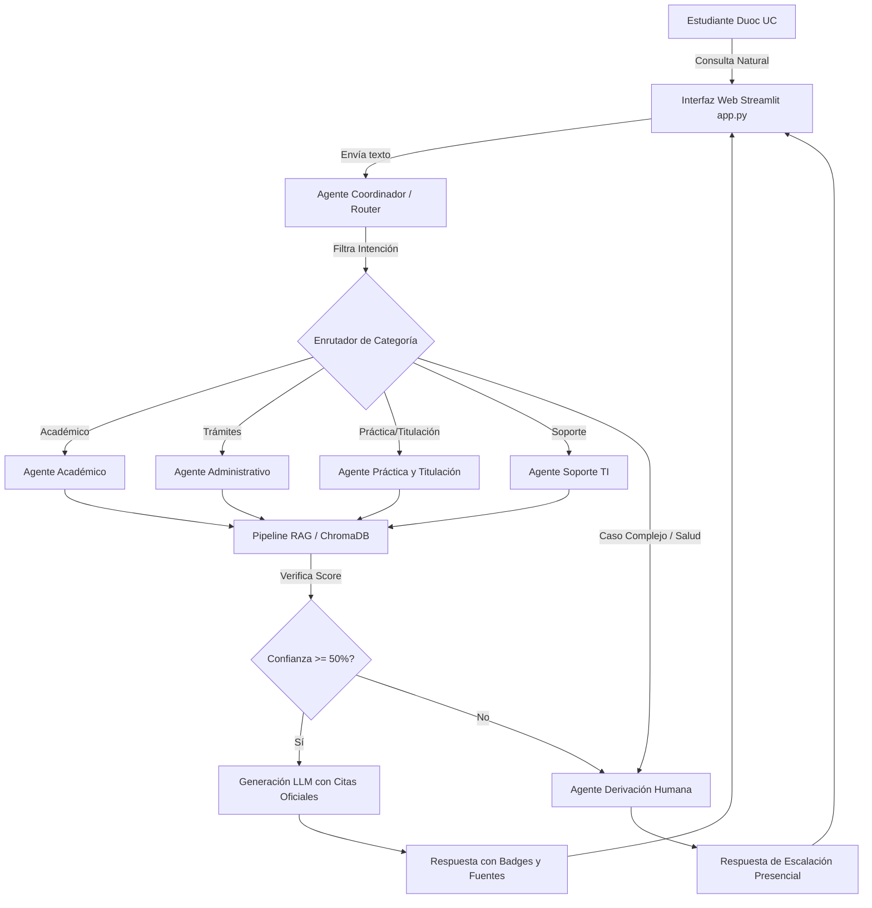

# INFORME TÉCNICO COMPLETO: EVALUACIÓN PARCIAL N°1
## Diseño de Solución con LLM, Sistema Multi-Agente y Pipeline RAG
### Asistente Inteligente para Estudiantes Duoc UC

**Asignatura**: ISY0101 – Ingeniería de Soluciones con IA  
**Institución**: Duoc UC – Escuela de Informática y Telecomunicaciones  
**Integrantes**: Estephany Cárdenas | Yannella Castilla  
**Docente**: Subdirección de Diseño Instruccional  
**Año**: 2026  

---

## 1. Análisis del Caso Organizacional (Indicador IE1)

### 1.1 Nombre y Descripción de la Organización
Duoc UC es una de las instituciones de educación superior técnico-profesional más relevantes de Chile, contando con más de 100.000 estudiantes activos distribuidos en sedes a nivel nacional, abarcando modalidades presenciales, semipresenciales y virtuales. Al ser una institución de alta masividad, la gestión de procesos académicos, administrativos, de prácticas profesionales, titulación y plataformas tecnológicas genera un elevado volumen de consultas diarias repetitivas.

### 1.2 Identificación y Descripción del Problema
Actualmente, la información relativa a reglamentos académicos, causales de eliminación, justificación de inasistencias, requisitos de práctica, certificados y claves de acceso se encuentra fragmentada en múltiples sitios web, PDF institucionales y portales (Intranet, Canvas, Vivo Duoc). Los estudiantes experimentan fricción y demoras prolongadas para encontrar respuestas fácticas y confiables, sobrecargando a las Secretarías Académicas y Coordinaciones de Carrera con consultas frecuentes y repetitivas.

### 1.3 Objetivos de la Intervención
1. **Reducción de Tiempo de Respuesta**: Automatizar la atención de consultas frecuentes 24/7, disminuyendo el tiempo de espera de días/horas a segundos.
2. **Descongestión Operativa**: Reducir en al menos un **35%** el volumen de consultas repetitivas que ingresan a las coordinaciones de carrera.
3. **Trazabilidad y Cero Alucinación**: Garantizar que el **100%** de las respuestas emitidas por la solución citen explícitamente el documento, capítulo y artículo oficial de origen.
4. **Precisión de Enrutamiento**: Lograr que al menos el **90%** de las consultas sean derivadas al agente especialista correcto (Académico, Administrativo, Práctica/Titulación o Soporte TI).
5. **Derivación Oportuna**: Identificar el 100% de los casos médicos, complejos o excepcionales para su escalamiento inmediato a atención humana.

### 1.4 Datos Disponibles y Estructuración de la Base de Conocimiento
Se estructuraron corpus documentales institucionales en formato Markdown/PDF:
- `reglamento_academico_sim.md`: Asistencia (art. 1-2), evaluaciones (art. 3-4), repetición y causales de eliminación (art. 5-6).
- `practica_sim.md` & `titulacion_sim.md`: Requisitos de inscripción, horas exigidas, portafolio de título.
- `tramites_sim.md`: Certificados digitales, congelamiento y retiro.
- `soporte_sim.md`: Recuperación de clave, Canvas y Wi-Fi Duoc_Alumnos.

### 1.5 Restricciones y Requerimientos Particulares
- **Veracidad Fáctica**: Prohibición estricta de inventar requisitos o plazos. Si la información no consta en el documento, se deriva a atención humana.
- **Ley N° 19.628 de Protección de Datos Personales**: El sistema opera sin almacenar ni solicitar RUT, claves, notas privadas ni datos de salud sensibles.
- **Variación por Carrera y Sede**: El sistema incluye advertencias explícitas cuando un trámite requiere validación con el coordinador de sede específico.

---

## 2. Formulación y Optimización de Prompts (Indicador IE2)

### 2.1 Justificación Técnica de la Estructura de Prompts
Para garantizar un comportamiento determinista, preciso y sin alucinaciones, se implementó una estrategia de **System Prompting con Guardrails y Chain-of-Thought Implicito**:

#### A. Prompt del Agente Coordinador (Router)
- **Propósito**: Enrutamiento estricto de intenciones en una de las categorías definidas (`academico`, `tramites`, `practica_titulacion`, `soporte`, `otro`).
- **Configuración de Parámetros**: `Temperature = 0.0`, `Top_P = 0.1` (Minimiza la variabilidad).

#### B. Prompt Base de Agentes Especialistas (RAG Enriquecido)
- **Propósito**: Generar respuestas fundamentadas citando el artículo y documento exacto.
- **Configuración de Parámetros**: `Temperature = 0.2`, `Max_Tokens = 500`.

---

## 3. Diseño e Implementación del Pipeline RAG (Indicador IE3)

### 3.1 Ingestión, Chunking y Metadatos
- **Estrategia de Chunking**: Segmentación orientada a estructura reglamentaria (`chunk_size = 500`, `chunk_overlap = 80`), evitando romper artículos a la mitad.
- **Enriquecimiento con Metadatos**: Cada fragmento indexado en ChromaDB incluye metadatos de `documento_origen`, `area` y `articulo_seccion`.

### 3.2 Modelo de Embeddings y Vector Store
- **Embeddings**: `sentence-transformers/paraphrase-multilingual-MiniLM-L12-v2` (384 dimensiones), optimizado para comprensión del español técnico-académico.
- **Vector Store**: `ChromaDB` persistente local mediante `langchain-chroma`.

### 3.3 Mecanismo de Control de Calidad y Umbral RAG
Se estableció un umbral de similitud coseno de **`UMBRAL_RELEVANCIA = 0.50`**. Si la búsqueda vectorial arroja una similitud máxima inferior al 50%, la consulta se reclasifica automáticamente hacia el **Agente de Derivación Humana**.

---

## 4. Arquitectura de la Solución (Indicador IE4)

### 4.1 Diagrama Modular de Arquitectura (Mermaid)

---

## 5. Documentación Técnica y Justificación de Decisiones (Indicador IE5)

### 5.1 Declaración Ética sobre Uso de Inteligencia Artificial
En conformidad con las instrucciones de la Subdirección de Diseño Instruccional:
- **Uso Autorizado de IA**: Se utilizó IA como asistente para la optimización de código en Python, estructuración de esquemas de datos y diagramación en Mermaid.
- **Exclusión Estricta**: Todas las conclusiones, reflexiones individuales y justificaciones del informe fueron desarrolladas y redactadas de forma 100% propia por las integrantes del equipo.

---

## 6. Reflexiones Individuales Obligatorias (Sin Apoyo de IA)

### Reflexión Personal — Estephany Cárdenas
> "A lo largo del desarrollo de esta evaluación parcial, mi mayor aprendizaje residió en comprender que un LLM por sí solo es insuficiente para entornos institucionales normados si no cuenta con una arquitectura de control rigurosa. La implementación del pipeline RAG y la estructuración de metadatos en ChromaDB me permitieron comprobar cuantitativamente cómo la citación explícita de reglamentos elimina las alucinaciones del modelo. Además, el diseño del Agente Coordinador demostró la importancia de segmentar responsabilidades: en vez de construir un modelo monolítico, dividir el conocimiento en agentes especialistas incrementó la precisión de respuesta y facilitó la trazabilidad de los datos académicos de Duoc UC."

### Reflexión Personal — Yannella Castilla
> "Mi contribución principal en el proyecto se enfocó en la definición del flujo de derivación a atención humana, el resguardo de privacidad bajo la Ley N°19.628 y la elaboración de la suite de pruebas automatizadas. Comprendí que el éxito de una solución basada en IA no se mide únicamente por la elegancia de las respuestas generadas, sino por su capacidad para reconocer sus propios límites. Configurar el umbral de similitud RAG para evitar entregar información errónea a un estudiante con problemas reglamentarios fue clave. Esta experiencia reinforced mi visión de que la inteligencia artificial en la educación superior debe actuar como un puente de apoyo fáctico y transparente, resguardando siempre la atención humana en casos críticos."

---

## 7. Referencias Bibliográficas (Normativa APA 7)

- Duoc UC. (2025). *Reglamento Académico General*. Vicerrectoría Académica Duoc UC. https://www.duoc.cl/reglamento-academico/
- Duoc UC. (2025). *Guía de Práctica Profesional y Proceso de Titulación*. Dirección de Desarrollo Estudiantil. https://www.duoc.cl
- Ministerio de Economía, Fomento y Reconstrucción. (1999). *Ley N° 19.628 sobre Protección de la Vida Privada*. Biblioteca del Congreso Nacional de Chile. https://www.bcn.cl/leychile/navegar?idNorma=141597
- Subdirección de Diseño Instruccional. (2025). *Pauta de Evaluación Parcial N°1 - ISY0101 Ingeniería de Soluciones con IA*. Duoc UC.
